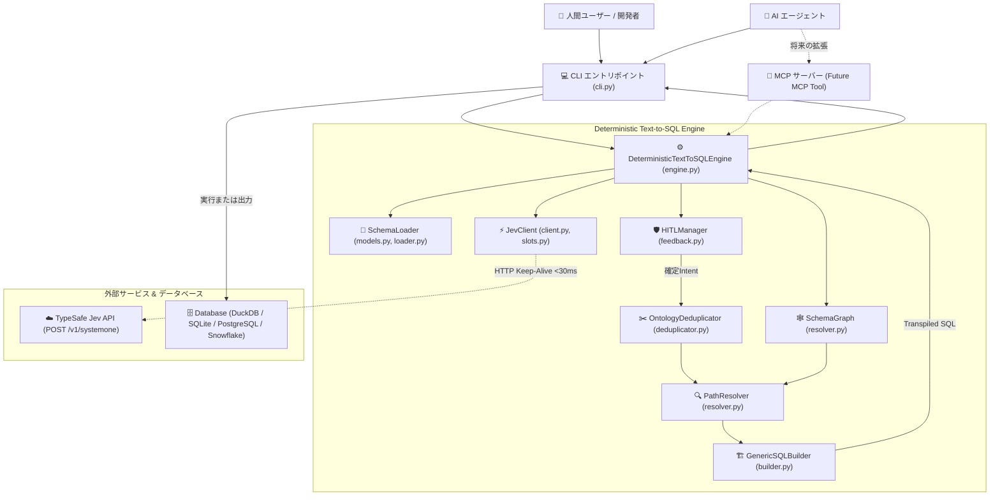
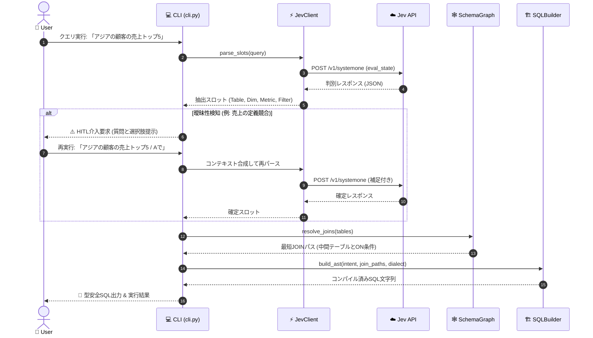
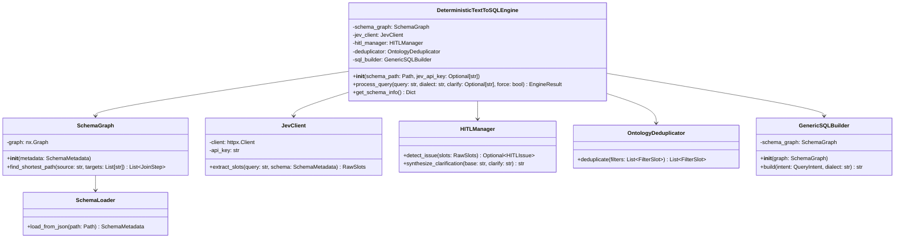

# 詳細設計書 (design.md)

## 目次
- [1. 機能一覧](#機能一覧)
- [2. 機能詳細](#機能詳細)
  - [2.1 機能カテゴリ1: セマンティックメタデータ管理](#機能カテゴリ1-セマンティックメタデータ管理)
  - [2.2 機能カテゴリ2: Jevスロット抽出 & 判別連携](#機能カテゴリ2-jevスロット抽出--判別連携)
  - [2.3 機能カテゴリ3: 決定論的JOIN解決 & AST生成](#機能カテゴリ3-決定論的join解決--ast生成)
  - [2.4 機能カテゴリ4: Human-in-the-Loop (HITL) 対話解決](#機能カテゴリ4-human-in-the-loop-hitl-対話解決)
  - [2.5 機能カテゴリ5: CLI・エージェント連携 & コアエンジン](#機能カテゴリ5-cliエージェント連携--コアエンジン)
- [3. アーキテクチャ](#アーキテクチャ)
  - [3.1 設計方針](#設計方針)
  - [3.2 全体構成図](#全体構成図)
  - [3.3 レイヤー構造](#レイヤー構造)
  - [3.4 全体シーケンス図](#全体シーケンス図)
  - [3.5 データフロー図 (DFD)](#データフロー図-dfd)
- [4. インターフェース](#インターフェース)
  - [4.1 CLI インターフェース](#cli-インターフェース)
  - [4.2 Python API インターフェース](#python-api-インターフェース)
  - [4.3 データ仕様 (スキーマメタデータ JSON)](#データ仕様-スキーマメタデータ-json)
- [5. コンポーネント設計](#コンポーネント設計)
  - [5.1 クラス図概要](#クラス図概要)
  - [5.2 クラス詳細仕様 (IPO)](#クラス詳細仕様-ipo)
- [6. エラーハンドリング & 信頼性設計](#エラーハンドリング--信頼性設計)

---

## 機能一覧

| 機能カテゴリ | 機能ID | 機能名 | 概要 | 対応要件ID |
|:------------|:-------|:------|:-----|:----------|
| セマンティックメタデータ | F-META-01 | スキーマメタデータローダー | JSONスキーマからテーブル、カラム、役割、値域を検証・ロード | 要件 A-1 |
| セマンティックメタデータ | F-META-02 | スキーマグラフ構築器 | 外部キー参照を有向/無向グラフとしてモデル化し保持 | 要件 A-2 |
| スロット抽出 | F-JEV-01 | 超並列スロット抽出器 | 自然言語から主テーブル、軸、指標、フィルタを並列抽出 | 要件 B-1, E-1 |
| スロット抽出 | F-JEV-02 | ホワイトリストChoiceバインダー | 固定区分値やコード値をメタデータの許容値へ厳格バインド | 要件 B-2 |
| ASTコンパイル | F-COMP-01 | 最短経路JOINリゾルバー | スロット間の外部キー最短経路を探索し自動JOIN句を導出 | 要件 C-1 |
| ASTコンパイル | F-COMP-02 | 階層オントロジー縮退器 | 親子階層フィルタの冗長親条件を自動縮退・削除 | 要件 C-2 |
| ASTコンパイル | F-COMP-03 | 型安全ASTビルダー | sqlglotを用いてASTノードを構築し複数ダイアレクトへ変換 | 要件 C-3, E-2 |
| HITL対話解決 | F-HITL-01 | 曖昧性検知 & 介入要求器 | 多重選択状態から曖昧クエリを検出しユーザー確認を発行 | 要件 D-1 |
| HITL対話解決 | F-HITL-02 | スラッシュ構文パーサー | クエリ末尾のスラッシュ補足を解釈しコンテキスト合成再実行 | 要件 D-2 |
| CLI / エージェント | F-CLI-02 | AIエージェント向け機械可読出力 | 完全構造化JSON出力モード（--json）とスキーマ自己検査 | 要件 D-3 |
| コアエンジン | F-CORE-01 | 統合エンジン (MCP対応設計) | CLI/MCP非依存の純粋サービスクラス。将来のMCPツール化を担保 | 要件 E-3 |

---

## 機能詳細

### 機能カテゴリ1: セマンティックメタデータ管理

- **F-META-01: スキーマメタデータローダー**
  - **概要**: JSON形式のセマンティックメタデータをPydanticモデルにマッピングし、厳格な型チェックとバリデーションを実施する。
  - **対応要件**: 要件 A-1
  - **設計のポイント**: カラムごとに `role`（`id`, `dimension`, `metric`, `fk`, `attribute`）と `agg`（集約関数候補 `SUM`, `AVG`, `COUNT` 等）を保持し、後続のJev判別用プロンプトとASTビルダーへ正確なコンテキストを提供する。

- **F-META-02: スキーマグラフ構築器**
  - **概要**: テーブル間の外部キー（FK）参照関係を `networkx.Graph` に登録し、テーブル結合の探索空間を構成する。
  - **対応要件**: 要件 A-2
  - **設計のポイント**: 各エッジに結合条件（結合元テーブル.カラム = 参照先テーブル.カラム）を付加し、最短パスが求まった際に即座にSQLのON句を生成可能にする。

### 機能カテゴリ2: Jevスロット抽出 & 判別連携

- **F-JEV-01: 超並列スロット抽出器**
  - **概要**: TypeSafe Jev API（`POST /v1/systemone`）に自然言語ステートを渡し、多変量スロット（テーブル、軸、指標、フィルタ種別、数値リテラル）を <30ms で一括判別する。
  - **対応要件**: 要件 B-1, E-1
  - **設計のポイント**: HTTP Keep-Alive と接続プールを維持する `httpx.Client` を用い、通信オーバーヘッドを最小化する。

- **F-JEV-02: ホワイトリストChoiceバインダー**
  - **概要**: メタデータ内の `values`（例: `region.r_name` の `["ASIA", "EUROPE", ...]`）に定義された値のみを有効なフィルタ値として型安全に採用する。
  - **対応要件**: 要件 B-2
  - **設計のポイント**: 未知の文字列やSQLインジェクション構文が混入した場合は無視または無効化し、クエリへの混入を物理的に遮断する。

### 機能カテゴリ3: 決定論的JOIN解決 & AST生成

- **F-COMP-01: 最短経路JOINリゾルバー**
  - **概要**: 抽出されたスロットに関与する全テーブル（起点テーブル、ディメンションテーブル、メトリックテーブル、フィルタテーブル）を結ぶ最短経路を NetworkX 上で探索する。
  - **対応要件**: 要件 C-1
  - **設計のポイント**: 複数のテーブルが存在する場合、主テーブルをルートとして各目的ノードへの最短パス（Dijkstra/BFS）を計算し、重複ノードを順序を保ってマージする。

- **F-COMP-02: 階層オントロジー縮退器**
  - **概要**: 親子関係（例: `region (親)` と `nation (子)`）にある複数のフィルタが同時に抽出された場合、冗長な親フィルタを削除する。
  - **対応要件**: 要件 C-2
  - **設計のポイント**: スキーマ定義の親子関係オントロジーを参照し、「日本」が指定されている場合は「アジア」条件を不要と判断して除外する。

- **F-COMP-03: 型安全ASTビルダー**
  - **概要**: `sqlglot.expressions` を用いて、`Select`, `From`, `Join`, `Where`, `Group`, `Order`, `Limit` ノードを純粋関数として組み立てる。
  - **対応要件**: 要件 C-3, E-2
  - **設計のポイント**: 文字列結合を一切行わず、AST構造体としてSQLを生成。指定ダイアレクト（PostgreSQL, DuckDB, SQLite, BigQuery, Snowflake等）へのトランスパイルを行う。

### 機能カテゴリ4: Human-in-the-Loop (HITL) 対話解決

- **F-HITL-01: 曖昧性検知 & 介入要求器**
  - **概要**: クエリから意図を単一に特定できない競合状態（例: 売上＝明細合計なのか伝票合計なのか）を検知し、安全に処理を一時停止して確認要求を発行する。
  - **対応要件**: 要件 D-1
  - **設計のポイント**: 勝手な推測による誤クエリ実行を防ぐため、HITL Issue オブジェクト（質問文、選択肢リスト）を生成し、戻り値コード `2` または専用ステータスを返却する。

- **F-HITL-02: スラッシュ構文パーサー**
  - **概要**: 入力末尾の `/ Aで` や `--clarify A` をパースし、ベースクエリと追加指定を分離・合成してJevへ再投入する。
  - **対応要件**: 要件 D-2
  - **設計のポイント**: ユーザーが元のクエリを打ち直すことなく、最短の手数で曖昧性を解消できるようにする。

### 機能カテゴリ5: CLI・エージェント連携 & コアエンジン

- **F-CLI-02: AIエージェント向け機械可読出力 & スキーマ自己検査**
  - **概要**: AIエージェントからのCLI呼び出しに対応し、完全な構造化JSON出力モード（`--json`）および登録スキーマの自己検査機能（`schema` サブコマンド）を提供する。
  - **対応要件**: 要件 D-3
  - **設計のポイント**: 人間向けRich装飾のない純粋なJSON（status, sql, hitl_summary, latency_ms）を出力し、エージェントが結果をそのままパースしてツール実行できるようにする。

- **F-CORE-01: 統合エンジン (DeterministicTextToSQLEngine)**
  - **概要**: CLIやMCPなどの外部フレームワークから完全に独立したコアサービスクラス。スキーマロード、スロット抽出、HITL判定、グラフ探索、ASTビルドを統合オーケストレーションする。
  - **対応要件**: 要件 E-3
  - **設計のポイント**: 将来のMCPツール化（FastMCPやmcp-pythonなど）の際、MCPツールハンドラーから `engine.generate_sql(query, ...)` を1行呼び出すだけで連携可能とする。

---

## アーキテクチャ

### 設計方針
1. **決定論的コンパイル (Deterministic Compilation)**: 自然言語の揺らぎはJevによるスロット正規化で吸収し、その後のJOIN解決およびSQL生成は完全な純粋関数として決定論的にコンパイルする。
2. **型安全性の数学的保証 (Type Safety & Hallucination-Free)**: スキーマ定義とASTノードの型安全性を活用し、存在しないテーブル・カラムの幻覚やSQL構文エラーを 0 件にする。
3. **超低遅延パイプライン (Sub-100ms Latency)**: Jev API（<30ms）＋ グラフ探索（<1ms）＋ ASTコンパイル（<3ms）により、全体レイテンシを100ms未満で処理する。
4. **Human-in-the-Loop ファースト (HITL by Design)**: 曖昧性があるときは無理に推測せず、ユーザーに選択肢を提示して安全に確定させる。
5. **将来のMCP化を見据えた脱結合 (MCP-Ready Decoupled Architecture)**: CLI表示層とコアロジックを厳格に分離し、コアエンジン `DeterministicTextToSQLEngine` は純粋Pythonオブジェクトとしてあらゆるクライアント（CLI / MCP Server / FastAPI / Python SDK）から再利用可能にする。

### 全体構成図
以下の図は、入力された自然言語クエリが各コンポーネントを経て型安全なSQLへコンパイルされる静的構成と依存関係を示しています。CLIと将来のMCPサーバーの双方が同一のコアエンジンを利用可能な構造です。

### レイヤー構造
1. **Presentation / Entry Layer (`cli.py`, API)**: 引数解析、スラッシュ構文パース、ターミナル出力（Rich）、JSONレスポンス
2. **Semantic / Interpretation Layer (`jev/`, `hitl/`)**: Jev API通信、スロットパース、曖昧性検出、HITL対話管理
3. **Graph / Relational Layer (`graph/`, `schema/`)**: セマンティックメタデータ管理、Pydanticバリデーション、NetworkX最短経路探索
4. **Compilation Layer (`compiler/`)**: 階層オントロジー縮退、sqlglot ASTアセンブリ、ダイアレクト別トランスパイル

### 全体シーケンス図
以下のシーケンス図は、自然言語クエリからHITL判定を経て決定論的SQLが生成される代表的な実行フローを示しています。

### データフロー図 (DFD)
以下の図は、入力文字列がどのような内部データ構造に変換され、最終的なSQLになるかを示しています。

```mermaid
flowchart LR
    RawQuery["自然言語文字列"] -->|スラッシュ解析| ParsedInput["Base Query ＋ Clarification"]
    ParsedInput -->|Jev推論| RawSlots["Jev Raw Choice / Slot JSON"]
    RawSlots -->|バリデーション| Intent["決定論的 Intent オブジェクト"]
    Intent -->|オントロジー縮退| OptimizedIntent["縮退済み Intent (冗長条件排除)"]
    OptimizedIntent -->|FKグラフ探索| JoinPlan["結合計画 (Table, ON句リスト)"]
    JoinPlan -->|ASTノード構築| SQLGlotAST["sqlglot AST (Select式)"]
    SQLGlotAST -->|トランスパイル| OutputSQL["ダイアレクト別 SQL 文字列"]
```

---

## インターフェース

### CLI インターフェース
TyperおよびRichによる対話的CLIツールを提供します。

- **入力**:
  - `query` (str, 必須): 自然言語クエリ（スラッシュ構文 `query / 補足` を含む）
  - `--schema` (Path, オプション): セマンティックメタデータJSONパス
  - `--dialect` (str, デフォルト: `postgres`): SQLダイアレクト (`postgres`, `duckdb`, `sqlite`, `snowflake`, `bigquery`)
  - `--clarify` (str, オプション): HITL選択補足キー (`A`, `B` 等)
  - `--json` (bool, デフォルト: `False`): JSON形式での結果出力
  - `--execute` (bool, デフォルト: `False`): 生成SQLを接続先DBで即座に実行
- **処理概要**:
  1. クエリ文字列をパースし、必要に応じてJev APIを呼び出す。
  2. 曖昧性がある場合はHITL画面（またはJSON）を出力しステータスコード2で一時停止。
  3. 確定IntentからFKグラフ探索とASTビルドを行い、SQLを表示/実行する。
- **出力**:
  - コンソール表示（Richカラーフォーマット）または構造化JSON（`latency_ms`, `intent`, `sql`, `hitl_summary`）

### Python API インターフェース

#### 1. `SchemaGraph.find_shortest_path`
- **入力 (Input)**:
  - `source_table`: str (起点テーブル名)
  - `target_tables`: List[str] (結合対象テーブル名リスト)
- **処理概要 (Processing)**:
  - NetworkXの無向/有向グラフ上でダイクストラ法を実行し、指定テーブル群を最小コストで包含する結合経路とON句を導出する。
- **出力 (Output)**:
  - `List[Tuple[str, str, str]]` (結合先テーブル, 結合元キー, 結合先キー のタプルリスト)

#### 2. `GenericSQLBuilder.build`
- **入力 (Input)**:
  - `intent`: Dict[str, Any] / IntentModel (主テーブル、ディメンション、指標、フィルタ条件)
  - `dialect`: str (出力SQLダイアレクト)
- **処理概要 (Processing)**:
  - `sqlglot.expressions` のノード（`select`, `from_`, `join`, `where`, `group_by`, `order_by`, `limit`）を純粋関数として組み立て、最適化・トランスパイルを行う。
- **出力 (Output)**:
  - `str` (フォーマット済み型安全SQL文字列)

### データ仕様 (スキーマメタデータ JSON)
- **フォーマット**: JSON (UTF-8)
- **構成**:
  - `tables`: リスト（テーブル定義）
    - `name`: str (テーブル物理名)
    - `description`: str (テーブル論理説明)
    - `aliases`: List[str] (自然言語エイリアス)
    - `primary_key`: List[str] (PKカラム名)
    - `foreign_keys`: List[Dict] (`column`, `ref_table`, `ref_column`)
    - `columns`: List[Dict] (`name`, `type`, `description`, `role`, `agg`, `values`)

---

## コンポーネント設計

### クラス図概要
以下の図は、主要コンポーネントとデータモデルのクラス関係を示しています。

### クラス詳細仕様 (IPO)

| クラス名 | メソッド名 | 入力 (Input) | 処理概要 (Processing) | 出力 (Output) |
|:---------|:-----------|:-------------|:----------------------|:--------------|
| `DeterministicTextToSQLEngine` | `process_query` | `query: str, dialect: str, clarify: Optional[str], force: bool` | スロット抽出からHITL判定、JOIN解決、ASTビルドまでのE2E実行 | `EngineResult` (成功/HITL要求/エラー) |
| `DeterministicTextToSQLEngine` | `get_schema_info` | なし | 登録されているテーブル・カラム・エイリアス情報の辞書化 | `Dict[str, Any]` |
| `SchemaLoader` | `load_from_json` | `path: Path` | JSONパース及びPydanticバリデーション | `SchemaMetadata` |
| `SchemaGraph` | `find_shortest_path` | `source: str, targets: List[str]` | NetworkX 最短パス探索とON句生成 | `List[JoinStep]` |
| `JevClient` | `extract_slots` | `query: str, schema: SchemaMetadata` | Jev API呼び出しとスロット辞書化 | `RawSlots` |
| `HITLManager` | `detect_issue` | `slots: RawSlots` | 多重選択競合の検知 | `Optional[HITLIssue]` |
| `OntologyDeduplicator` | `deduplicate` | `filters: List[FilterSlot]` | 親子オントロジーに基づく冗長親条件除外 | `List[FilterSlot]` |
| `GenericSQLBuilder` | `build` | `intent: QueryIntent, dialect: str` | sqlglot AST構築とトランスパイル | `str` (SQL文字列) |

---

## エラーハンドリング & 信頼性設計

1. **Jev API 通信エラー**:
   - タイムアウト（デフォルト 3000ms）または 5xx エラー発生時、リトライ（最大2回）を実施。復帰不可時は `JevAPIConnectionError` を送出し、ユーザーにフォールバックオプションを提示。
2. **スキーマ未定義カラム・テーブルの検出**:
   - Pydantic バリデーションにより、メタデータに存在しないカラムやテーブルがIntentに含まれた場合、即座に `SchemaValidationError` を発生させ不正なSQL構築をブロック。
3. **グラフ非連結エラー**:
   - スロットに関与するテーブル間にFKリレーションが存在しない（孤立ノード）場合、意図しないデカルト積（CROSS JOIN）を防ぐため `UnconnectedSchemaError` を送出。
